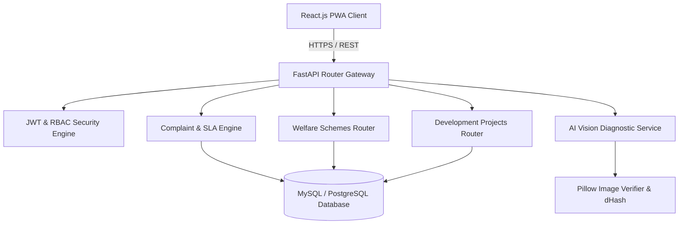

# JANSEVA – DEVELOPER GUIDE & ARCHITECTURE REFERENCE

## 1. Architecture Overview
JANSEVA follows a decoupled, cloud-ready architecture:
- **Client Layer**: Single Page Application (SPA) + Progressive Web App (PWA) with React 18, Vite, and Tailwind CSS.
- **API & Application Layer**: RESTful asynchronous Python microservices using FastAPI, Pydantic, and Uvicorn.
- **Data Persistence**: SQLAlchemy ORM with a normalized relational schema supporting multi-tenant isolation.
- **AI Computer Vision Pipeline**: Pillow (PIL) quality assessment, Difference Hash (dHash) perceptual duplicate screening, defect classification heuristics, and optional OpenAI API integration.



---

## 2. Directory Structure
```
janseva/
├── backend/
│   ├── app/
│   │   ├── core/         # Security, JWT, bcrypt hashing
│   │   ├── models/       # SQLAlchemy models (User, Complaint, Scheme, Project, etc.)
│   │   ├── routers/      # FastAPI endpoint routers
│   │   ├── schemas/      # Pydantic request/response schemas
│   │   ├── services/     # AI Computer Vision, verification, hashing
│   │   ├── config.py     # Pydantic Settings & environment variables
│   │   ├── database.py   # SQLAlchemy session factory & engine
│   │   └── main.py       # FastAPI application entrypoint
│   ├── seed_data.py      # Multi-tenant role, ward, user & scheme seed script
│   ├── requirements.txt  # Python package specifications
│   ├── Procfile          # Render / PaaS deployment process file
│   └── Dockerfile        # Container image definition
├── frontend/
│   ├── public/
│   │   ├── manifest.webmanifest # PWA configuration
│   │   ├── sw.js               # Service Worker caching & offline engine
│   │   ├── offline.html        # Resilient offline fallback interface
│   │   └── icon-192.svg        # Vector app icons
│   ├── src/
│   │   ├── components/         # AI, Home, Common & Navigation components
│   │   ├── context/            # AuthContext, LanguageContext
│   │   ├── layouts/            # DashboardLayout, PublicLayout
│   │   ├── pages/              # Role-specific & public page components
│   │   ├── App.jsx             # React Router DOM configuration
│   │   └── index.css           # Tailwind directives & custom CSS
│   ├── tailwind.config.js      # XINTRA theme color palette
│   ├── vite.config.js          # Vite build config
│   └── vercel.json             # Vercel SPA routing & cache headers
└── .github/workflows/ci-cd.yml # GitHub Actions pipeline
```

---

## 3. Database Schema Models
1. **`Organization`**: Multi-tenant entity (PMC, BMC, TMC) with jurisdiction boundaries.
2. **`Ward` & `Area`**: Administrative geographical subdivisions.
3. **`Department`**: Municipal departments (Electrical, Roads, Water, Drainage, Solid Waste, Health).
4. **`Role` & `User`**: Granular role-based access control (`SUPER_ADMIN`, `ORG_ADMIN`, `NAGAR_SEVAK`, `STAFF`, `CITIZEN`).
5. **`Complaint` & `AIVerificationLog`**: Grievances, SLA deadlines, assigned staff, and AI diagnostics.
6. **`Scheme`**: Central, State, and Municipal welfare schemes with eligibility rules and document checklists.
7. **`DevelopmentProject` & `ProjectMilestone`**: Ward capital expenditure budgets, milestones, and contractor details.
8. **`ConsentRecord`**: Statutory audit logging under DPDPA 2023.

---

## 4. Running Tests & Verifications
- Run backend router verification:
  ```bash
  cd backend
  python direct_test.py
  ```
- Run frontend production build:
  ```bash
  cd frontend
  npm run build
  ```
